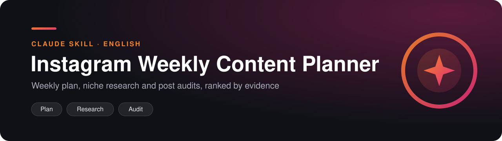

<p align="center"></p>

<p align="center">
  
  
  
</p>

<p align="center"><b>Weekly plan, niche research and post audits, ranked by evidence</b></p>

---

## ✨ What it does

A Claude skill that runs the weekly content loop for any Instagram account in three modes: **Plan** the week, **Research** what works in the niche, and **Audit** past posts. Everything is ranked by evidence, not raw views.

- **Outlier ratio:** views ÷ the median of the account's last 12 reels. 400k views is a quiet day for a 2M account and a breakthrough for a 4k one.
- **18-formula hook bank** shared by all three modes, so you can see which formulas keep working week after week.
- **Plan:** 4–5 posts a week, type balance (proof, lesson, opinion, story, series), a hook formula per slot, a daily 20-minute engagement round.
- **Audit:** sends per reach and follows per reach; separates hook problems from profile problems and ends with STOP / MORE.
- **Safe:** never posts, likes, follows, logs in or scrapes; the user publishes.

## 🧾 Example output

```
WEEK OF: 27 Oct
TUE  08:30  REEL      PROOF    #4  Time collapse    - Ford assembly line
THU  19:30  CAROUSEL  LESSON                        - Toyota's 5 Whys
FRI  08:30  REEL      OPINION  #3  Nobody tells you
SUN  20:00  REEL      STORY    #13 Mid-sentence
```

## 💬 How to use

Once installed, just ask Claude in plain language:

> "Plan next week for my founder-stories account."  
> "Research what's working in the personal-finance niche this month."  
> "Here are my last 12 posts' insights. Audit them."  

## ⚙️ Install

**Claude Code**
```bash
git clone https://github.com/erencalik/instagram-weekly-content-planner-claude.git ~/.claude/skills/instagram-weekly-content-planner
```
**claude.ai:** download the repo as a ZIP (Code → Download ZIP) and upload it under Settings → Capabilities → Skills.

<details>
<summary>Files</summary>

| | |
|---|---|
| `SKILL.md` | the skill itself |
| `README.md` | this page |
| `assets/banner.svg` | banner |
| `LICENSE` | MIT |

</details>

## 🔗 Works well with

| Repo | What it does |
|---|---|
| [`is-hikayesi-icerik-uretici-claude`](https://github.com/erencalik/is-hikayesi-icerik-uretici-claude) | Şirket ve kurucu hikayelerinden doğrulanmış carousel ve Reels |
| [`instagram-aciklama-carousel-metni-claude`](https://github.com/erencalik/instagram-aciklama-carousel-metni-claude) | Caption, hashtag, alt metin ve carousel metni, kontrol makbuzuyla |
| [`sosyal-medya-metni-insanlastirma-claude`](https://github.com/erencalik/sosyal-medya-metni-insanlastirma-claude) | Türkçe metinden yapay zeka izlerini temizler, beş kontrolle puanlar |

All skills and how they connect: [`claude-skills-collection`](https://github.com/erencalik/claude-skills-collection)

## 📄 Credits & license

Adapted from the `ig-plan`, `ig-viral`, `ig-audit` skills and `ig-reel/hooks.json` in [Jakeschincariol/instagram-agent-skill](https://github.com/Jakeschincariol/instagram-agent-skill) (MIT), merged into one file; the hook bank was rewritten for third-person storytelling and made niche-neutral. MIT licensed, see [LICENSE](LICENSE).
